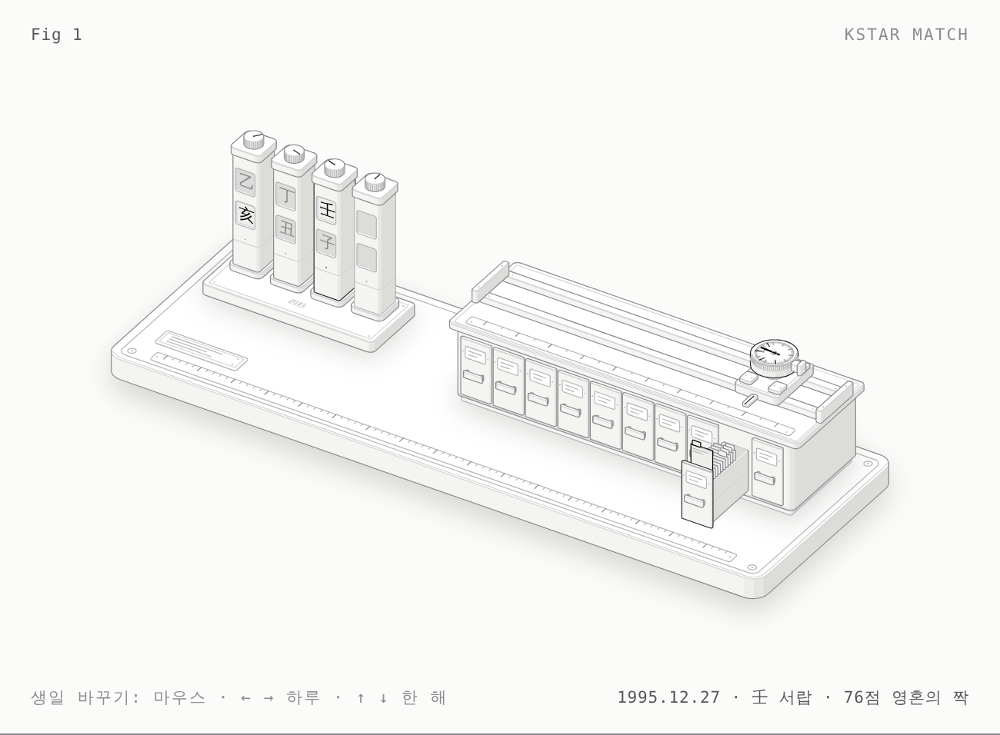

# Product Anatomy

내 제품들을 하나씩 **실제로 만들 수 있는 기계**로 그리는 프로젝트입니다.
상자와 화살표 대신, 제품이 하는 일이 곧 그 기계의 작동이 되도록 부품을 설계하고,
그림 속 숫자와 움직임은 그 제품의 코드에서 옮긴 모델이 그대로 만듭니다.

그림은 [Anatomy](https://github.com/wheresryan22/anatomy) Claude 스킬(MIT)로 그립니다.
이 저장소의 `.claude/skills/anatomy/`에 들어 있어서, 이 저장소에서 Claude Code를 열면 `/anatomy`로 바로 쓸 수 있습니다.

## 갤러리

| 제품 | 물체 | 그림 | 해부 노트 |
|---|---|---|---|
| KStar Match | 사주 카드 선별기 — 네 기둥, 천간 서랍 10개, 점수 다이얼 | [라이트](products/kstarmatch/kstarmatch-light.html) · [다크](products/kstarmatch/kstarmatch.html) | [노트](products/kstarmatch/README.md) |

[](products/kstarmatch/README.md)

`index.html`은 `products.json`으로 만든 갤러리 페이지입니다(정적 호스팅에 그대로 올릴 수 있음).

## 구조

```
.claude/skills/anatomy/   Anatomy 스킬 (wheresryan22/anatomy @ 1482e84, MIT, PDF 제외)
products.json             제품 목록 — 갤러리와 build-all이 읽음
products/<slug>/
  README.md               해부 노트: 개념→부품 표, 숫자, 그리면서 발견한 것, 부품 목록
  model.mjs               제품 코드에서 옮긴 순수 모델 (그림의 모든 숫자의 출처)
  build.mjs               그림 빌드 → <slug>.html, <slug>-light.html
  cover.png               갤러리용 스크린샷
scripts/
  kit.mjs                 스킬 키트 import 지점
  build-all.mjs           모든 제품 + index.html 빌드
  shoot.mjs               Playwright 스크린샷 (확대 검토용)
index.html                갤러리 (생성됨)
```

## 새 제품 그리기

1. `products.json`에 제품을 추가합니다 (`status: "planned"`).
2. Claude Code에서: `/anatomy <제품>의 아나토미를 그려줘. 근거 코드는 <저장소/경로>` — 스킬이 크기 판단 → 사실 수집 → 물체 발명 → 부품 목록 → 빌드 → 검증 순으로 진행합니다.
3. 순서는 `products/kstarmatch/`를 본보기로:
   - **Truth first**: 제품 코드의 규칙을 `model.mjs`로 옮기고, 가능하면 원본 코드와 대조 테스트.
   - **Invent the object**: "무엇이 움직이고, 그 움직임이 무슨 뜻인가"를 한 문장으로.
   - **Parts list**: 40개 이상, 모든 부품이 다른 부품 위에 놓이게.
   - `node scripts/build-all.mjs <slug>` → `node scripts/shoot.mjs …`로 4배 확대해 검토.
4. 해부 노트에 개념→부품 표와 **그리면서 발견한 것**을 남깁니다. (KStar Match에서는 한국 시간대에서 일간이 하루 밀리는 버그가 나왔습니다.)

## 실행

```sh
node scripts/build-all.mjs                 # 전체 빌드 (의존성 없음, Node 20.10+)
node scripts/build-all.mjs kstarmatch      # 한 제품만
node scripts/shoot.mjs products/kstarmatch/kstarmatch-light.html shots/k.png --scale 4 --zoom 420,270,150,110
python3 -m http.server                     # http://localhost:8000 에서 갤러리 보기
```

`shoot.mjs`는 전역 설치된 Playwright를 씁니다. 스킬의 `scripts/capture.mjs`·`drive.mjs`·`lines.mjs`(Chrome 원격 디버깅)도 로컬에서는 그대로 쓸 수 있습니다.

## 이전 내용

이 저장소는 원래 KStar Match(kstarmatch.com) 사이트의 배포 저장소였습니다(`kfortunes/`).
그 코드는 브랜치 **`archive/kstarmatch-2026-01`**에 그대로 남아 있습니다(마지막 배포 커밋 `2526a60`):

```sh
git fetch origin archive/kstarmatch-2026-01
git checkout origin/archive/kstarmatch-2026-01 -- kfortunes TECHNICAL_ANALYSIS.md   # 필요하면 복원
```

## 라이선스

`.claude/skills/anatomy/`는 Ryan(wheresryan22)의 MIT 라이선스 코드입니다(`LICENSE` 참고).
`products/*/build.mjs`의 창(recess) 그리기는 스킬의 `examples/desk-computer`에서 가져왔습니다.
