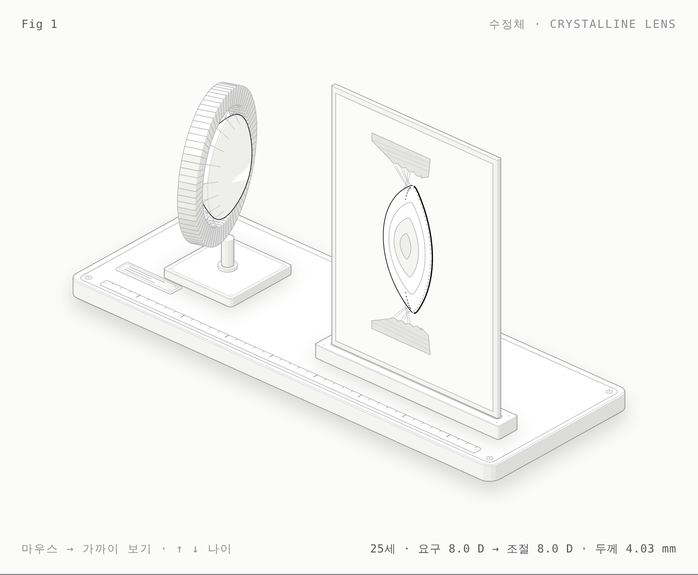

# 수정체 · Crystalline lens — 해부 노트

> **검수 전** — 해부학적 내용과 수치는 사용자 검수 후 이 줄을 지웁니다.



- 그림: [`lens-light.html`](lens-light.html) · [`lens.html`](lens.html) (다크)
- 조작: 마우스를 오른쪽으로 → 근거리 요구 0 → 8 D · `←` `→` 0.5 D씩(Shift 2 D) · `↑` `↓` 나이 5세씩(10~70세) · 가만두면 25세와 60세를 번갈아 보여줍니다.

## 한 문장

근거리를 볼수록 모양체근이 수축해 모양체 고리가 좁아지고 섬모소대의 장력이 풀리면, 수정체가 제 탄성으로 두꺼워지고 앞면이 더 휘어 굴절력이 커집니다. 나이가 들면 근육과 소대는 그대로 움직이지만 수정체가 따라가지 못합니다(노안).

## 모형 부품 ↔ 해부 구조

| 모형 | 해부 구조 |
|---|---|
| 받침대 위 고리 (72조각) | 모양체(ciliary body) — 조각 하나가 모양체 돌기(ciliary process, 약 70개) 하나쯤 |
| 고리와 수정체를 잇는 가는 선 | 섬모소대(Zinn 소대, zonular fibers): 앞면·적도·뒷면 부착, 앞뒤 섬유가 엇갈림 |
| 고리 가운데의 볼록한 몸체 (lit) | 수정체(crystalline lens), 앞면이 오른쪽 |
| 단면판 위아래의 삼각형 | 모양체근 단면, 안쪽 가장자리의 물결 = 모양체 돌기 |
| 단면판의 굵은 바깥선 | 수정체낭(lens capsule): 앞쪽이 두껍고 뒤극이 얇음 |
| 앞면 안쪽의 점 한 줄 | 수정체 상피(lens epithelium): 앞면에만 있는 단층, 적도에서 활 모양(lens bow)으로 이어짐 |
| 바깥에서 안으로 겹친 띠 | 피질(cortex) → 성인핵 → 태아핵 → 배아핵 |

## 수치와 출처

`model.mjs`에 값마다 표시가 붙어 있습니다. **[확인]** 문헌 수치 확인 · **[확인 필요]** 원문 대조 전 · **[도식]** 그림을 위한 단순화.

| 값 | 식 / 값 | 출처 | 상태 |
|---|---|---|---|
| 조절력(평균) | 18.5 − 0.30 × 나이 (D) | Hofstetter | 확인 |
| 전면 곡률반경 (비조절) | 12.9 − 0.057 × 나이 (mm) | Dubbelman | 확인 |
| 전면 곡률 (조절 A D) | 1/R = 1/R₀ + 0.0067 × A | Dubbelman 기반 나이·조절 눈 모형 | 확인 |
| 후면 곡률반경 (비조절) | 6.2 − 0.012 × 나이 (mm) | Dubbelman & Van der Heijde 2001 | 확인 |
| 후면 곡률 (조절) | 1/R = 1/R₀ + 0.0040 × A | Dubbelman 2005의 약 −0.13 mm/D를 환산 | 확인 필요 |
| 두께 (비조절) | 2.93 + 0.0236 × 나이 (mm) | Dubbelman (기울기는 피질 12+8, 핵 3 µm/년과 일치) | 확인 필요 (절편) |
| 두께 (조절) | + 0.064 mm/D | Richdale 2013 (30~50세) | 확인 |
| 등가 굴절률 | 1.441 − 0.00039 × 나이 | Dubbelman 2001 | 확인 필요 |
| 굴절력 | 두꺼운 렌즈 식, 방수·유리체 1.336 | — | 계산 |
| 적도 지름 | 두 구면 교차(비조절), 조절 1 D당 −0.05 mm | MRI 약 0.3~0.4 mm/최대조절 | 확인 필요 |
| 모양체 고리 수축 | 지름 최대 −0.64 mm, 나이와 무관 | Strenk 2006 | 확인 |
| 수축 정도 | 근거리 요구 / 8 D | Strenk의 자극량 가정 | 확인 필요 |
| 수정체–모양체 틈 | 0.8 mm (비조절) | — | 확인 필요 |
| 핵 층 비율, 소대 처짐, 고리 폭 | — | — | 도식 |
| 수정체낭 두께 | 실제 수~수십 µm, 그림은 과장 | — | 도식 |

계산 예 (모형): 25세 비조절 두께 3.52 mm·굴절력 24.1 D → 4 D 조절 시 3.78 mm·28.0 D. 60세는 비조절 4.35 mm, 조절력 0.5 D.

## 임상 연결

- **노안**: 그림에서 60세로 올리면 고리와 소대는 25세와 똑같이 움직이지만 수정체 두께는 거의 그대로입니다 — 렌즈 경화(lenticular) 쪽 설명. 모양체근 수축이 나이로 줄지 않는다는 MRI 결과(Strenk 2006)와 맞습니다.
- **나이에 따른 두께 증가**: 비조절 두께가 25세 3.5 → 60세 4.3 mm로 늘어 전방이 얕아지는 방향 — 폐쇄각 위험과 연결.
- **수정체낭**: 앞쪽이 두껍고 뒤극이 얇음 — 백내장 수술 중 후낭 파열이 뒤극에서 쉬운 이유.
- **상피는 앞면에만**: 수술 후 후낭혼탁은 적도부 상피세포가 뒤로 이동·증식해 생깁니다.

## 모형 부품 수

받침판(발 4, 홈, 나사 4, 1 mm 눈금자, 라벨판), 스탠드(받침, 기둥, 칼라), 모양체 고리 72조각, 섬모소대 18경선 × 3, 수정체, 단면판(홀더, 판, 모양체 단면 2 + 근섬유, 소대 12, 수정체 층 4, 수정체낭 앞뒤, 상피 세포, lens bow).

## 만들기

```sh
node figures/lens/build.mjs --light && node figures/lens/build.mjs
node scripts/shoot.mjs figures/lens/lens-light.html shots/lens.png --keys End
```
