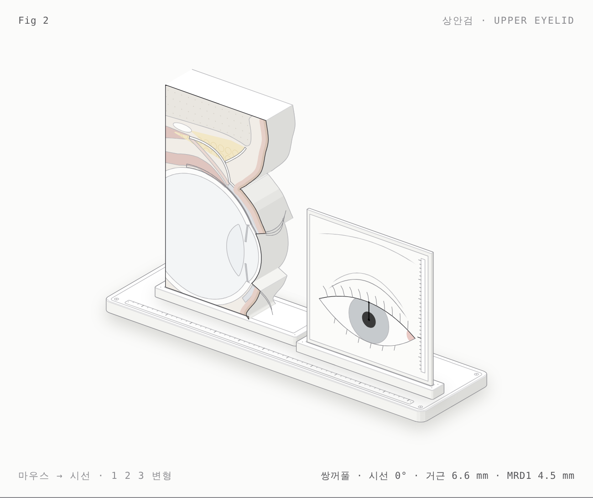

# 상안검 · Upper eyelid — 해부 노트

> **검수 전** — 해부학적 내용과 수치는 사용자 검수 후 이 줄을 지웁니다.



- 그림: [`upper-eyelid-light.html`](upper-eyelid-light.html) · [`upper-eyelid.html`](upper-eyelid.html) (다크)
- 조작: 마우스를 좌우로 → 시선 −30°~+30° · `←` `→` 5°씩 · `1` 쌍꺼풀 · `2` 홑꺼풀 · `3` 건막성 안검하수 (`↑` `↓`로도 바꿈) · 가만두면 차례로 보여줍니다.

## 한 문장

시선을 올리면 상안검거근이 수축해 Whitnall 인대 아래에서 방향을 바꾼 건막과 뮐러근이 검판을 끌어올리고, 눈꺼풀 테가 안구를 따라 미끄러지며 각막반사와의 거리(MRD1)를 유지합니다. 격막이 건막과 만나는 높이가 쌍꺼풀과 홑꺼풀을, 건막이 검판에서 떨어지면 안검하수를 만듭니다.

## 모형 부품 ↔ 해부 구조

| 모형 | 해부 구조 |
|---|---|
| 받침대에 세운 두께 약 7 mm 판 | 동공을 지나는 시상 단면 표본 (앞쪽이 오른쪽) |
| 바깥쪽 분홍 띠 두 겹 | 피부와 안륜근(검판앞·격막앞·안와 부분) |
| 흰 가는 띠(위에서 내려옴) | 안와격막: 안와테두리(arcus marginalis)에서 시작해 건막과 융합 |
| 노란 영역과 동그라미 | 건막 앞 지방(preaponeurotic fat) |
| 흰 띠(수직으로 올라가 뒤로 꺾임) | 상안검거근 건막 |
| 건막 뒤 분홍 가는 띠 | 뮐러근(상검판근): 거근에서 갈라져 검판 위 테두리에 붙음 |
| 안구 위 푸른 회색 판 | 상검판(tarsus)과 마이봄샘(안쪽 선) |
| 흰 타원 | Whitnall 인대(상횡인대) 단면 |
| 위쪽 분홍 띠 두 개 | 상안검거근 근복(위), 상직근(아래) |
| 점무늬 영역 | 안와 천장(전두골)과 안와테두리 |
| 눈꺼풀 뒷면의 회색 선 | 결막: 검판 결막 → 원개 → 안구 결막 |
| 오른쪽 판 | 같은 오른눈의 정면, 각막반사–윗눈꺼풀 테 = MRD1, mm 자 |

## 수치와 출처

`model.mjs`에 값마다 표시가 붙어 있습니다. **[확인]** 문헌 수치 확인 · **[확인 필요]** 원문 대조 전 · **[도식]** 그림을 위한 단순화.

| 값 | 그림 | 출처 | 상태 |
|---|---|---|---|
| MRD1 정상 | 4.5 mm | EyeWiki: 4–5 mm | 확인 |
| 거근 기능 정상 | 시선 ±30°에서 13.3 mm | EyeWiki: 12–17 mm | 확인 |
| 거근 근복 길이 | (단면 밖까지 이어짐) | 사체 연구 약 40–42 mm | 확인 |
| 건막·뮐러근이 갈라지는 높이 | 검판 위 약 10 mm | 국내 사체 연구 10–12 mm | 확인 |
| 뮐러근 높이 | 약 10 mm (그림) | 같은 연구 약 13.7 mm | 확인 (그림은 짧음) |
| 격막–건막 융합 (쌍꺼풀) | 검판 위 3.7 mm | 서양인 사체 3.7 mm (연구마다 3–10 mm) | 확인 |
| 융합 (홑꺼풀) | 검판 앞면, 위 테두리 아래 6 mm | 동양인에서 더 낮음 (정성적) | 확인 필요 (높이) |
| 쌍꺼풀 주름 높이 | 테 위 7 mm | 동양인 수술 설계 6–8 mm (중앙값 7) | 확인 |
| 상검판 높이 | 9.5 mm | 교과서 8–12 mm | 확인 필요 |
| Whitnall 인대 | 검판 위 테두리에서 건막 경로로 약 14 mm | 교과서 14–20 mm | 확인 필요 |
| 상직근 부착 | 각막 가장자리 뒤 7.7 mm | Tillaux 나선 | 확인 필요 |
| MRD2, 하검판 높이 | 5.5 mm, 4 mm | — | 확인 필요 |
| 안구 | 반지름 12, 각막 곡률 7.8, 각막 세로 10.6 mm | 평균값 | 확인 필요 |
| 건막성 안검하수 | MRD1 1.5 mm, 건막 부착이 검판 위로 4 mm, 주름 10.5 mm | 정성적 특징만 확인 | 도식 |
| 연부조직 두께·주름 모양·지방 모양 | — | — | 도식 |

## 임상 연결

- **쌍꺼풀 vs 홑꺼풀**: 격막이 건막과 높게 만나면 건막 앞 지방이 위에 머물고 건막 섬유가 피부에 닿아 주름이 생깁니다. 낮게(검판 앞) 만나면 지방이 아래로 내려와 눈꺼풀이 두툼하고 주름이 없습니다 — 매몰법·절개법에서 무엇을 고정하는지와 연결.
- **건막성 안검하수**: 건막이 검판에서 떨어져 늘어나면 거근은 정상으로 움직여 **거근 기능은 정상**인데 **MRD1이 낮고 주름이 높아**집니다. 그림에서 `3`을 누르고 시선을 움직이면 거근 이동 거리는 그대로이고 MRD1만 낮습니다.
- **뮐러근**: 교감신경 지배 평활근으로, 검판 위 테두리에 붙어 1–2 mm의 거상을 더합니다(페닐에프린 검사, 뮐러근 절제술의 해부학적 근거).
- **Whitnall 인대**: 거근의 진행 방향을 앞뒤에서 위아래로 바꾸는 지지점 — 거근 절제술에서 보존해야 하는 구조.

## 모형 부품 수

받침판(발 4, 홈, 나사 4, 눈금자), 단면 받침(홈, 나사 4), 단면 표본(앞면 층: 뼈+결, 안구 벽, 방수·유리체, 홍채 2, 수정체, 상직근, 거근, 지방+소엽, Whitnall, 상·하검판, 마이봄샘, 뮐러근, 건막, 격막, 결막, 안륜근, 피부, 속눈썹 5, 회색선 / 두께: 윤곽을 따라 뽑은 면, 테·주름·위 절단선), 정면판(홀더, 판, 위·아래 테, 홍채·동공, 누구, 속눈썹, 주름선, 접힘선, 눈썹, MRD1 선과 점, mm 자).

## 만들기

```sh
node figures/upper-eyelid/build.mjs --light && node figures/upper-eyelid/build.mjs
node scripts/shoot.mjs figures/upper-eyelid/upper-eyelid-light.html shots/lid.png --keys 3
```
