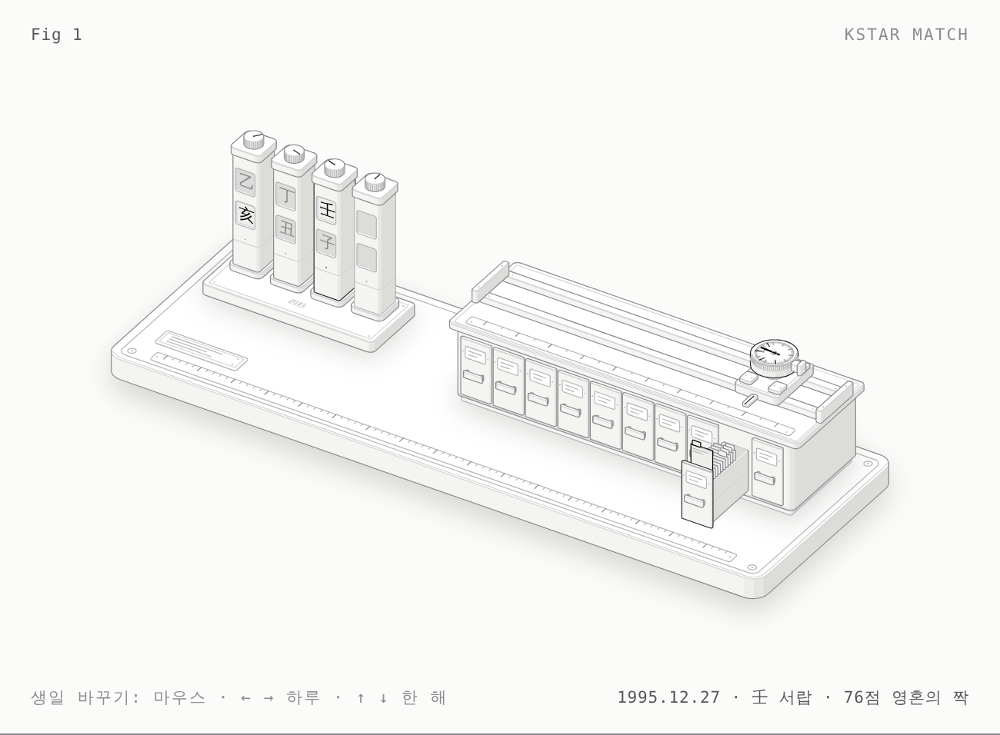

# KStar Match — 해부 노트



- 그림: [`kstarmatch-light.html`](kstarmatch-light.html) · [`kstarmatch.html`](kstarmatch.html) (다크)
- 제품: https://kstarmatch.com
- 근거 코드: 이 저장소의 브랜치 `archive/kstarmatch-2026-01`(커밋 `2526a60`)의 `kfortunes/` (2026년 1월, Cloudflare Pages 배포본).
  이후 `JungyulPark/kstarmatch` 저장소에서 바뀐 부분은 아직 반영하지 않았습니다.

## 한 문장

생년월일이 네 기둥에 여덟 글자를 세우면, 그중 **일간(日干)** 한 글자가 캐리지를 열 개의 천간 서랍 중 하나로 보내고,
그 서랍이 열리며 맨 앞 스타 카드(트윈)가 솟고, 다이얼이 점수를 읽습니다.

## 개념 → 부품

| 제품 개념 | 그림 속 부품 |
|---|---|
| 사주팔자 (연·월·일·시) | 받침대 위 기둥 4개, 기둥마다 창 2개(천간 위, 지지 아래) |
| 일간 (Day Master) | 일주 기둥 위 창 — 진하게 표시(키 글자) |
| 연지(띠) | 연주 기둥 아래 창 — 진하게 표시(키 글자) |
| 시주 (선택 입력) | 빈 창의 네 번째 기둥: 매칭에 쓰이지 않음 |
| `celebrities.js` 데이터 100명 | 캐비닛 서랍 10개(천간별) × 카드 10장 |
| 한국 스타 우선 정렬 | 한국 스타 카드는 왼쪽 탭, 서랍 앞쪽에 꽂힘 |
| `findBestTwin` 1위 | 맨 앞 카드가 솟아오름 (lit) |
| `calculateTwinScore` | 캐리지 위 다이얼 게이지: 바늘 = 점수 |
| `MATCH_GRADES` 40/55/70/85 | 다이얼의 진한 눈금 4개 |
| `Math.random() * 10` | 다이얼 안쪽 호: 같은 생일이라도 점수가 움직이는 범위 |

## 숫자 (모두 `model.mjs`에서 계산)

- 일주: `1900-01-31`부터 지난 날수 mod 10 / mod 12.
- 연주: `(year − 4) mod 10/12`, 양력 1월 1일에 바뀜.
- 월주: 천간 `(연간 mod 5)·2 + 월 − 1`, 지지 `월 + 1` — 양력 달 기준.
- 트윈 점수 = 같은 일간 40 (같은 오행만이면 20) + 같은 띠 15 (삼합 8) + 같은 음양 10 + ⌊인기도/20⌋ (4~5) + ⌊random·10⌋, 25~98로 자름.
- 일간이 같으면 최소 54점, 다른 서랍의 최대는 40점 → 트윈은 항상 일간 서랍에서 나옵니다.
- 등급: 85 운명적 쌍둥이 · 70 영혼의 짝 · 55 같은 기운 · 40 비슷한 에너지 · 그 아래 다른 길.

`model.mjs`는 원본 `saju.js` / `celebrities.js`와 1940~2014년 7,404개 날짜에서 결과가 일치하는지 대조했습니다
(UTC 기준, 랜덤을 0과 0.999로 고정해 최저·최고 점수 모두 비교).

## 그리면서 발견한 것

모델을 원본과 대조하다 나온 실제 동작입니다. (2026-01 배포본 기준 — 현재 `kstarmatch` 저장소에서 고쳐졌는지는 확인 필요)

1. **일주 기준일 오류.** 코드는 1900-01-31을 甲子일로 두지만 실제로는 **甲辰일**입니다(율리우스일 2415051).
   일간(천간)은 맞지만 **일지(지지)는 모든 사용자에게 4칸 어긋나** 보입니다. 예: 2000-01-01은 실제 戊午일, 코드는 戊寅.
2. **시간대 버그 — 한국 사용자는 일간이 하루 밀림.** `calculateDayPillar`가 브라우저 **로컬** `Date`로 날짜를 뺍니다.
   서울의 1900년 시간대는 LMT +8:28, 지금은 +9:00이라 차이가 정수 일에서 32분 모자라고 `Math.floor`가 하루를 깎습니다.
   브라우저 시간대가 `Asia/Seoul`이면 1960~2010년 출생 **100%**가 전날의 일주(일간 포함)로 계산됩니다.
   서머타임 지역도 영향: `America/Los_Angeles` 55%, `Europe/London` 61%. `UTC`·`Asia/Tokyo`는 0%.
   → `Date.UTC(...)`로 빼면 고쳐집니다(`model.mjs`의 `dayPillar` 참고).
3. **연·월 경계가 절기가 아님.** 연주는 양력 1월 1일, 월주는 양력 달로 바뀝니다(입춘·절입 기준 아님).
   1~2월 초 출생자는 전통 만세력과 연주·월주가 다를 수 있습니다.
4. **점수에 랜덤.** 매 계산마다 0~9점이 더해져, 같은 생일도 새로고침하면 등급 경계(예: 69 ↔ 71)를 넘나듭니다.
5. **여덟 글자 중 두 글자만 매칭에 쓰임.** 일간과 연지뿐이고 월주·시주는 트윈 점수에 영향이 없습니다.
6. **데이터 개수.** 문서는 "200+ 연예인"이지만 실제 매칭은 `celebrities.js` 안의 100명(천간마다 10명)을 쓰고,
   `celebrities.json`은 `totalCount: 200`에 실제 170명입니다.

## 부품 목록 (약 110 solids)

| 묶음 | 부품 |
|---|---|
| 바닥 | 판, 발 4개(플랜지+발), 홈, 모서리 나사 4, 눈금자 띠, 라벨 판(나사 2, 줄 3) |
| 기둥 | 받침대(홈, 나사 4, `四柱` 각인), 기둥 4 × (플린스, 기둥, 이음선, 창 2, 캡, 손잡이, 널링, 지시선) |
| 캐비닛 | 받침, 몸체(이음선), 상판(홈), 인덱스 띠(서랍 중심 눈금 10, 사이 눈금 9), 레일 2, 스톱 2 |
| 캐리지 | 판(홈, 나사 4), 부싱 캡 4(나사 8), 지시 혀, 다이얼(칼라, 기둥, 퍽, 널링 띠, 베젤, 눈금 50, 등급 눈금 4, 크라운 2, 랜덤 호, 바늘, 허브) |
| 서랍 × 10 | 앞판, 라벨 홀더(카드, 줄 2, 리벳 2), 손잡이(기둥 2 + 바), 열린 서랍: 상자, 러너 선, 우물, 카드 10 + 탭 10 |

## 만들기

```sh
node products/kstarmatch/build.mjs           # 다크
node products/kstarmatch/build.mjs --light   # 라이트
node scripts/shoot.mjs products/kstarmatch/kstarmatch-light.html shots/k.png
```

`stars.json`은 원본 100명에서 이름을 뺀 값만 담습니다: `[천간, 출생연도, 인기도, 한국스타, 음, 분류]`.
